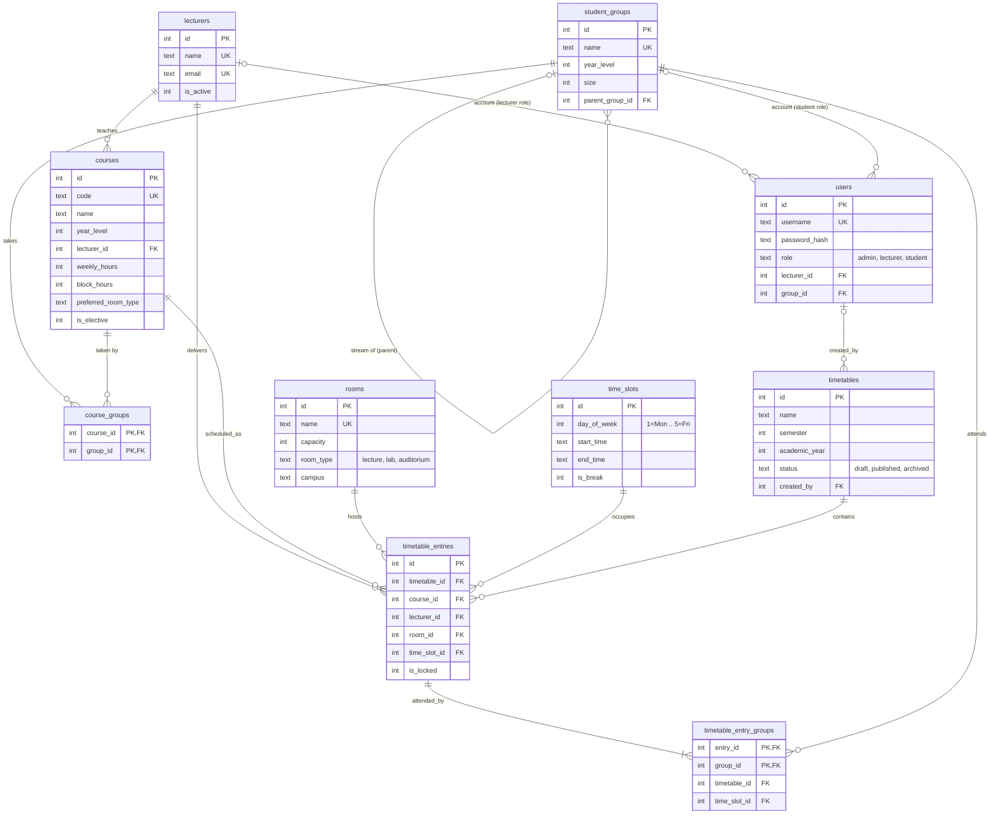

# Database Schema (Tickets 7 and 8)

Engine: **SQLite 3** with foreign keys on. The design uses standard SQL (UNIQUE, CHECK,
composite foreign keys), so moving to PostgreSQL or MySQL later only needs small type changes
and the triggers rewritten in that engine's syntax.

## Build it

```bash
python database/build_db.py          # fresh database at database/timetable.db
python -m pytest tests/test_database_constraints.py -v
```

Dev logins created by the build (local development only): `admin`, `bukasa` (lecturer),
`student_bsc1` (student), all with password `ChangeMe123!`.

## ER diagram



## How each hard constraint is enforced

| Rule | Mechanism |
|---|---|
| Lecturer in one place at a time | `UNIQUE (timetable_id, lecturer_id, time_slot_id)` on `timetable_entries` |
| Room used by one class at a time | `UNIQUE (timetable_id, room_id, time_slot_id)` on `timetable_entries` |
| Student group in one class at a time | `UNIQUE (timetable_id, group_id, time_slot_id)` on `timetable_entry_groups` |
| Group link matches its entry's slot | Composite FK `(entry_id, timetable_id, time_slot_id)` to `timetable_entries` |
| No classes at lunch | Trigger on `timetable_entries` using `time_slots.is_break` |
| Room big enough | Trigger on `timetable_entry_groups`: sum of group sizes must not exceed room capacity |
| Lecturer matches the course | Trigger on `timetable_entries` |
| Group takes the course | Trigger on `timetable_entry_groups` using `course_groups` |
| One published timetable per semester | Partial unique index on `timetables` |
| Account links match the role | `CHECK` on `users` (lecturer needs `lecturer_id`, student needs `group_id`) |

The solver (Tickets 9 and 10) should still check these itself for speed. The database is the
safety net: even a buggy solver or manual edit cannot save a clash.

## Design decisions

- **One entry per one-hour slot.** A 2-hour practical is two consecutive rows. `courses.block_hours`
  tells the solver to keep blocks together; the database does not enforce adjacency.
- **Versioned timetables.** Every generated result is a row in `timetables`. Constraints apply inside
  one timetable, so several drafts can exist side by side, and only `published` is shown to users.
- **Combined classes.** `timetable_entry_groups` lets one entry have several groups (the 2nd-year
  BAS622 and IPR622A are marked "combined").
- **Electives / streams.** The 3rd-year screenshot shows several modules in one slot. Model each
  elective stream as a sub-group (`parent_group_id`) so students only clash with their own stream.
  This is not seeded yet because the 3rd-year timetable is incomplete in the screenshot.
- **Room type is a preference, not a rule.** Real data shows the same course (DSC500) in both lecture
  rooms and a lab, so `courses.preferred_room_type` is advisory and left to the solver's soft scoring.
- **Manual overrides.** `timetable_entries.is_locked` marks entries an admin fixed by hand; the
  solver should not move them when regenerating.

## Seed data and assumptions to verify

Seeds come from the three Bryanston Semester 2 timetables. Items the screenshots do not show, and
that the team should confirm with Richfield:

- Room capacities and group sizes are placeholders (labs 40, lecture rooms 60, AUD 150, groups 35).
- `G10 L2` and `G10 LAB` are treated as separate rooms from `L2` and the other labs.
- Weekly hours for 2nd and 3rd year courses are estimates; 1st year (all 4 hours) was read exactly.
- ISM731's full name is unreadable, and the 3rd-year screenshot is cropped on the right, so that
  course list may be incomplete.
- Only the BSc 1st Year Group 1 timetable is loaded as a sample timetable (it came from a clean PDF).
  It loads with zero constraint violations.

## Notes for other tickets

- **Ticket 5 (auth):** the `users` table is ready; hashes are Werkzeug-compatible.
- **Ticket 6 (API):** use `v_timetable_full` for read endpoints; filter on `timetable_status = 'published'`.
- **Ticket 9 (solver):** read `courses`, `course_groups`, `rooms`, and non-break `time_slots`; write
  `timetable_entries` and `timetable_entry_groups`. A constraint error means the solver has a bug.
